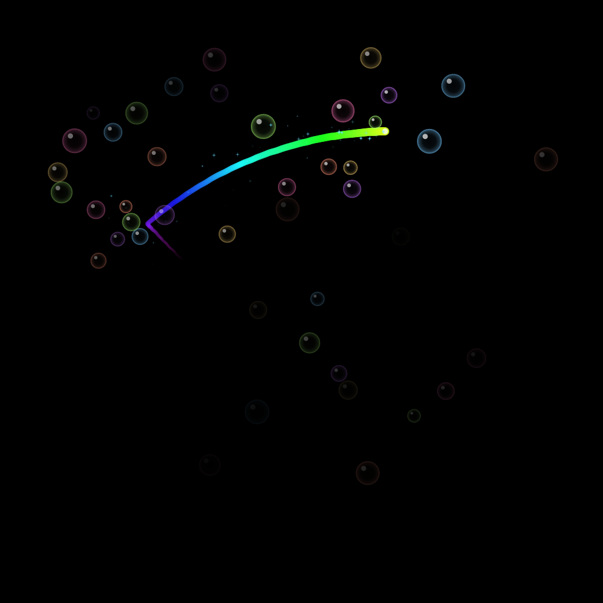

# MouseTrails

[](https://github.com/n3o59hf/MouseTrails/releases/tag/latest)

Playful cursor effects that live in your system tray. A little
rainbow icon sits near the clock; your cursor leaves a rainbow ribbon, soap
bubbles drift up from it (clicking blasts them all outward), and rings
ripple out when you click.




## Features

- **Profiles** — your looks, as named profiles with a live animated preview
  on every card. New profiles start from a **preset**: *Default* (the
  classic rainbow look), *Winter* (soft white trail with pink/blue halos,
  drifting snowflakes, pale sparkles) or *Christmas* (candy-striped trail,
  spinning ornament balls, golden bengal-fire sparks). Custom presets are
  JSON files, editable by hand.
- **Mouse Trail** — a ribbon that flows behind the cursor. Five styles:
  *Rainbow ribbon*, *Neon comet* (single color with glow), *Ghost fade*,
  *Soft glow* (bright core with two tinted halos) and *Candy stripes*
  (colors cycling along the trail).
- **Bubbles** — soap bubbles spawn as you move, drift upward with buoyancy,
  drag, wobble, and are gently pushed around by the cursor. Left-click pops
  nearby bubbles. Shapes: soap bubbles, tumbling **snowflakes** (skip
  collisions, fall gently) and **ornament balls** (spin from cursor speed,
  damp heavily).
- **Sparkles** — twinkling four-point stars (or soft dots) scatter as the
  cursor moves, with configurable gravity (negative floats up), optional
  motion streaks and generational child sparks (bengal-fire style).
- **Click ripples** — expanding rings from every left click.
- **Settings window** — every effect can be toggled and tuned live (rates,
  sizes, lifetimes, colors, trail style). Changes apply instantly and save
  automatically.
- **Start with Windows** — checkbox in the settings window (or the tray
  menu); writes/removes `HKCU\...\CurrentVersion\Run`.
- Single instance, click-through overlay (never intercepts input), settings
  apply across all monitors.

## Building

```
cargo build --release
```

The result is a **single self-contained `MouseTrails.exe`** (~4 MB): the C
runtime is statically linked (`.cargo/config.toml` sets
`target-feature=+crt-static`), panics abort (no unwinding tables), accesskit
(screen-reader support for the settings window) is compiled out, and the
binary is LTO-optimized and stripped — it needs no Visual C++
Redistributable, just copy the exe anywhere and run it (Windows 10/11; the
only imports are system DLLs like `opengl32` and `dwmapi`). Settings stay
per-user in `%APPDATA%\MouseTrails`. A convenience copy is kept
at the repo root (gitignored).

The exe carries the rainbow-ribbon icon (Explorer, taskbar, shortcuts) via an
embedded resource: `assets/mousetrails.ico` is generated once by
`regen-icon.cmd` (or `cargo run --release --example make_icon`) from the same
procedural painter the tray uses, and `build.rs` embeds it at compile time.

Optional flag:

- `--settings` — open the settings window at startup (if another instance is
  already running, it just brings its settings window to the front).

## Using it

The app starts minimized to the tray (it may be inside the `^` overflow next
to the clock — drag it onto the taskbar to pin it there):

- **Left-click** the tray icon — open Settings.
- **Right-click** — menu: *Open Settings…*, *Check for updates* / *Install
  update*, *Start with Windows*, *Exit*.

### Self-updating

MouseTrails checks the rolling [latest
release](https://github.com/n3o59hf/MouseTrails/releases/tag/latest) at
startup and every 6 hours (plus on demand from the tray menu or Settings →
Updates). When a newer build is published, one click downloads it, verifies
its SHA-256 checksum, swaps the exe in place and restarts — no installer, no
manual download. The previous binary is kept next to the exe as
`MouseTrails.prev.exe` until the next update. Updates are always explicit;
nothing is installed silently.

Settings are stored in `%APPDATA%\MouseTrails\config.json`.

## Themes

Themes live under `%APPDATA%\MouseTrails\`:

```
config.json                root config: active theme, per-theme profile
                           selection, render FPS
themes\<id>\
  theme.json               preset definition (custom presets only)
  default.json             profile: a complete effect-settings document
  <name>.json              named profiles
```

Profiles are the selector: a gallery of tiles, each with a live preview.
Clicking a tile applies that profile's complete settings, and the **+**
tile opens the create dialog — duplicate any existing profile, start from
any preset, or create a new preset on the spot. A new profile's preset
**starting point** overlays its themed sections on your current settings;
unthemed sections carry over. Every preset's primary profile is called
`main`. "Reset to defaults"
restores the profile's base preset values for themed sections and factory
defaults for the rest.

The three built-in presets ship inside the exe; their definitions are the
checked-in `themes/default.json`, `themes/winter.json` and
`themes/christmas.json` in the repository, which also serve as templates.
Creating a custom preset in the settings window copies the current preset's
definition into `themes\<your-preset>\theme.json` — edit that file with any
text editor and create a profile from it to apply it. A `theme.json` on
disk overrides a built-in definition of the same id, so you can also edit a
built-in preset that way. Presets are starting values only: slider ranges
are global, and presets never change once a profile exists.

**Expressions:** selected numeric fields accept either a number or a short
math expression string, evaluated once per frame:

```json
"buoyancy": "-20 + sin(t * 1.7) * 8",
"rate": "6 + speed / 200"
```

Variables: `t` (seconds since start), `speed` (smoothed cursor px/s),
`moving` (1 while moving, else 0), `pi`. Functions: `sin`, `cos`, `abs`,
`floor`, `ceil`, `round`, `sqrt`, `min(a, …)`, `max(a, …)`, `clamp(x, lo,
hi)`. Expressions are parsed when settings change (not per particle),
evaluated exactly once per frame, and their results are clamped to safe
ranges; a malformed expression falls back to the field's default. Fields:
`trail.width`, `trail.hue_speed`, `bubbles.rate`, `bubbles.buoyancy`,
`bubbles.wobble`, `bubbles.spin`, `sparkles.rate`, `sparkles.gravity`.
In the settings window such fields show a monospace editor; the `=` button
converts the expression back to a constant.

## How it works

- A fullscreen, transparent, click-through **layered window** (`WS_EX_LAYERED
  | WS_EX_TRANSPARENT | WS_EX_TOPMOST | WS_EX_TOOLWINDOW`) covers the virtual
  screen.
- A background **cursor sampler thread** polls `GetCursorPos` ~every
  millisecond (`timeBeginPeriod(1)` + `Sleep(1)`), so the trail follows the
  real cursor path — including direction changes that happen between render
  frames. Samples are interpolated to ≤4 px spacing and the ribbon is drawn
  with quadratic midpoint smoothing, which keeps it continuous and rounded
  even during fast, jerky movement.
- Effects are simulated and rendered on the main thread at a configurable FPS
  (`WM_TIMER`) into a 32-bit DIB via **tiny-skia** (software rendering, no GPU
  dependency). The DIB memory is handed to tiny-skia directly — zero copies.
- Colors are created with R/B pre-swapped so tiny-skia's RGBA output matches
  the BGRA layout `UpdateLayeredWindow` expects.
- Each rendered frame is pushed to the screen with
  `UpdateLayeredWindowIndirect` (full-window update — see note below), and
  only when something is actually animating; idle costs one timer tick.
- The tray icon is generated procedurally at startup (rainbow ribbon arc).
- Settings UI is **egui/eframe** on a worker thread (`winit`'s
  `any_thread(true)` via eframe's `event_loop_builder` hook — supported on
  Windows).

### Note on dirty rectangles

`UpdateLayeredWindowIndirect`'s `prcDirty` partial updates silently fail to
composite on some Windows builds (observed on Windows 11 26200), so this app
pushes the full window each rendered frame instead. The buffer is only
touched inside the effects' bounding box, so the CPU cost stays modest.

## Diagnostics

- `examples/screen_dump.rs` — captures the true composited screen (DXGI
  desktop duplication, includes layered windows that GDI captures miss):
  `cargo run --release --example screen_dump out.png [wait_ms]`
- `MOUSETRAILS_DEBUG=1` — log to `%TEMP%\mousetrails_debug.log`
- `MOUSETRAILS_DUMP=1` — dump the overlay's framebuffer to
  `%TEMP%\mousetrails_dump.png` (every 20 rendered frames)

## Project layout

```
src/main.rs         entry, single-instance guard, DPI awareness
src/overlay.rs      fullscreen layered window, tray icon + menu, render loop
src/effects.rs      effect simulation + tiny-skia rendering (trail, bubbles,
                    sparkles, ripples)
src/settings.rs     effect settings model (cfg structs shared by themes)
src/store.rs        config directory: root config, per-theme profiles,
                    theme definitions, legacy-config migration
src/themes.rs       built-in theme definitions (embedded JSON)
src/expr.rs         per-frame expression fields (pre-parsed, evalexpr)
src/preview.rs      animated theme previews for the settings window
src/settings_ui.rs  egui settings window + thread management
src/startup.rs      HKCU Run registry helpers
src/icon.rs         procedural tray/window icon
themes/             built-in theme JSONs (embedded; also authoring templates)
```
